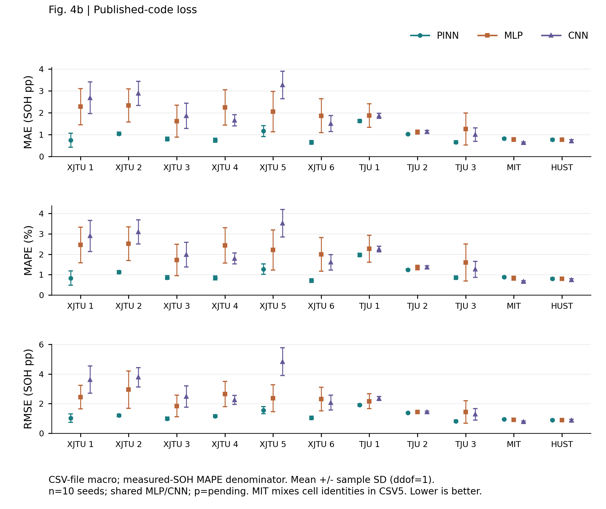
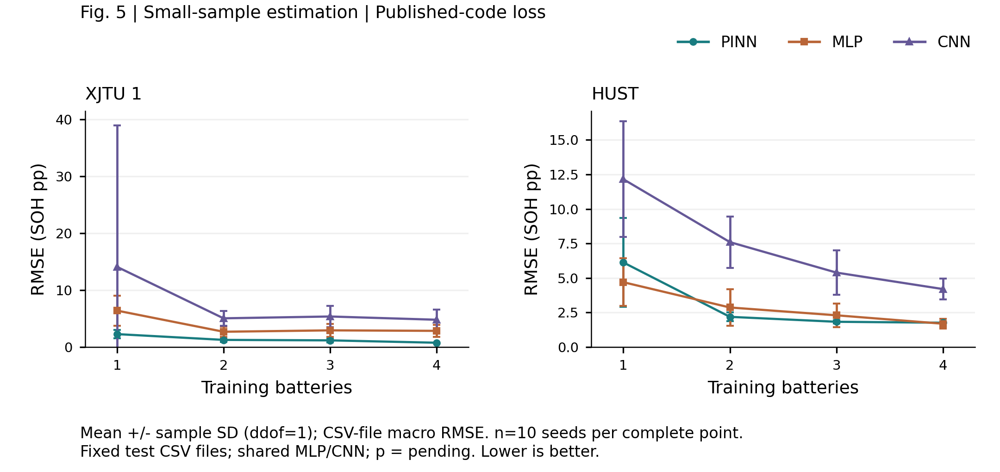

# PINN4SOH 论文复现与结果核验

这是对 Nature Communications 论文 **Physics-informed neural network for lithium-ion battery degradation stable modeling and prognosis** 的独立复现记录。这里把代码、真实实验结果、图表和未复现项放在一起，方便在线阅读和按需下载。

**主实验矩阵 2120/2120 已完成；这不表示论文所有数字和结论均已复现。** 本项目保留不利结果，不用最好的一次代替十次平均。实验截至 2026 年 11 月 11 日，本次公开整理日期为 2026 年 11 月 21 日。

**[打开中文成果看板](https://zhaopengbo-0702.github.io/PINN4SOH-Reproduction/) · [实验结果](docs/实验结果.md) · [未复现与限制](docs/未复现与限制.md) · [下载模型、日志和完整证据](../../releases/tag/v1.0.0)**

| 想了解什么 | 阅读入口 |
|---|---|
| 实际做了哪些实验，结果怎样 | [中文实验结果](docs/实验结果.md) |
| 哪些结论支持、哪些有反例 | [21 项结论表](outputs/full_reproduction/final_results_2120/independent_review_complete/claim_decisions_21.csv)、[25 项图表映射](outputs/full_reproduction/final_results_2120/independent_review_complete/figure_table_evidence_map_25.csv) |
| 原图、表格和逐电池曲线 | [图表目录](docs/图表目录.md) |
| 如何运行和复核 | [使用指南](docs/使用指南.md) |
| checkpoint、数组和训练日志在哪里 | [文件与下载说明](docs/文件与下载说明.md) |
| 指标口径、版本、作者代码与新增代码怎么区分 | [常见问题](docs/常见问题.md) |
| 所有历史代码及 Notebook | [源码全量索引](archive_code/README.md) |
| 完整数据与云端环境如何恢复 | [完整档案恢复指南](docs/完整档案恢复指南.md) |

## 完成了什么

| 工作 | 完成情况 | 如何理解 |
|---|---:|---|
| 常规估计 | 440 次 | PINN 两种论文损失实现与 MLP/CNN 对照分开，十次重复 |
| 小样本估计 | 1120 次 | 覆盖样本量变化与全部 XJTU 批次，重叠设置不重复计数 |
| 目标域独训补充 | 80 次 | 为迁移比较补齐相应 target-only |
| 迁移 | 480 次 | 作者源权重与独立复训源权重分别记录 |
| 主汇总图表 | 69 组 PNG＋PDF | 表格 CSV 保留论文值、实际值与差值 |
| 逐测试 CSV 曲线 | 82 组 PNG＋PDF | 固定 repeat1 展示，不按效果挑选 |
| 当前修正版默认参数 | 原有 110 次中的 MIT/HUST 20 次独立重核 | 与主 2120 的两种论文损失分支分开 |
| 保存模型的 CPU 复载 | 20/20 容差检查通过 | 0/20 预测逐位相同，最大差约 2.38e-7 SOH |
| 软件环境敏感性 | 110 配对 | 99 次新增旧栈训练＋11 次已有 repeat1 复用 |
| XJTU 替代搜索 | 192 次候选＋3 次选定测试 | 新划分、3 seed，选中 β=0，不能证明单调项贡献 |

这些数字对应不同协议，不能直接相加成“一套实验的重复次数”。未完成的额外调参已按用户要求撤出交付，不支持性能改进结论。

## 关键结果

下面是**作者修正版默认参数**的 MIT/HUST 各十次结果，均值±样本标准差（ddof=1）。它们不是主实验中按论文参数运行的 PINN 两分支结果。

| 数据集 | MAPE：全部样本合并（%） | MAPE：CSV 等权宏平均（%） | RMSE：全部样本合并（SOH 百分点） |
|---|---:|---:|---:|
| MIT | 0.689402 ± 0.028627 | 0.792423 ± 0.050746 | 0.902220 ± 0.042616 |
| HUST | 0.814535 ± 0.027752 | 0.799301 ± 0.030026 | 0.955581 ± 0.029957 |

原文 Table 2 的 MAPE 为 MIT 0.65%、HUST 0.78%。目前误差接近该量级，但聚合口径和发表历史配置未唯一恢复，没有同时达到原表 MAPE/RMSE 四位小数的精确复现门槛。[逐次完整指标](outputs/full_reproduction/current_repo_defaults_reaudited_20261111/metrics_per_run_20.csv) · [独立复核](outputs/full_reproduction/current_repo_defaults_reaudited_20261111/作者当前默认20次_独立复核.md)

### 主实验：精度与波动



图为论文参数的**标签单调实现**：11 组、CSV 等权、十次均值与样本标准差。MAE/MAPE/RMSE 共 33 个组指标中，27 个低于两个基线；MIT/HUST 未形成同时优于两基线的均值优势。预测单调实现为 0/33，不能把两种实现混成同一个结论。

### 小样本：并非每个设置都最好



标签实现的 MAPE/RMSE 在 28 个设置中各有 25 个同时优于两基线；样本数增加时也有局部回升。较小标准差与较高平均误差可以同时存在。

### 迁移：收益取决于对照

复训源权重相对其 source-only，两种损失均有 12/12 个方向的平均 RMSE 改善。与目标域独训比较，一电池条件仅 20/48 个组均值更低、28/48 更高；指定两电池范围为 7/24 更低、17/24 更高。组数不是独立 seed 胜率，也不能解释成纯预训练的因果效果。[迁移补充复核](outputs/full_reproduction/environment_schema_supplement_final/README.md)

## 仍不能声称完成的部分

- 两个原始 slope 特征的精确定义、MIT 原 MAT/单位及部分身份记录没有唯一恢复。
- 作者历史 grid、seed、软件栈、损失与发表 checkpoint 的绑定不完整。
- 总体 MAPE 的唯一权重口径和原 i5-10400F 相同条件计时未恢复。
- “所有任务最好”“普遍迁移获益”“完全无泄漏”等广泛结论存在反例或证据不足。

详细条件与证据见[未复现与限制](docs/未复现与限制.md)。原始冻结报告保持原字节，其较早状态由较新的中文说明澄清，不回写修改原结果。

## 文件怎样组织

```text
README.md                 中文总入口
docs/                     结果、限制、图表目录、使用指南与网页看板
outputs/full_reproduction/ 已完成结果、CSV、原图和复核报告
reproduction/             调度、审计、导出和绘图工具
PINN4SOH/                 实验时使用的作者源码快照（不含大型数据）
PUBLICATION_FILES.json    仓库所选原件的 SHA-256 索引
```

较大的模型、完整日志和数组使用 [GitHub Release](../../releases/tag/v1.0.0) 下载，具体范围和 SHA-256 见[下载说明](docs/文件与下载说明.md)。历史报告里的 `/workspace/...` 等路径是来源记录；按下载说明恢复目录后使用。

## 来源与引用

- [原论文与补充材料](https://doi.org/10.1038/s41467-024-48779-z)
- [作者原始仓库](https://github.com/wang-fujin/PINN4SOH)
- 本次实验源码参考提交：`cc3cc5053caf38f04e0665f7f88cb109144d035e`；实际版本以每次实验保存的源码 SHA 为准。

本仓库为独立复现与审计成果，不代表原作者。作者源码、第三方数据及论文材料的权利归原来源；新增工具、图表和说明的来源见[来源与使用说明](docs/来源与使用说明.md)。
